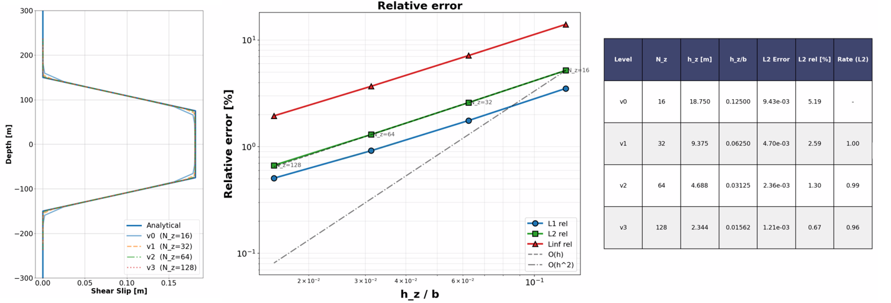

.. _unstableVerticalFault:

###########################################################
Shear Slip Along a Frictionless Vertical Fault
###########################################################

**Context**

This example is a companion to :ref:`stableVerticalFault`. It uses the same geometry, mesh, workflows (external and internal), solvers, discretization methods, constitutive models, and initial and boundary conditions. The only difference is the strength of the fault: here, both the friction coefficient and the cohesion are set to zero, so that the fault slips upon reservoir depletion. The model computes displacement discontinuities (fault slip upon reactivation) along the frictionless fault, which are verified against the corresponding analytical solution `(Jansen and Meulenbroek, 2022)  <https://njgjournal.nl/index.php/njg/article/view/11453/17972>`__.

Please refer to :ref:`stableVerticalFault` for a complete description of the problem and of the XML input files. Only the differences with that case are described below.

**Input file**

The xml input files for the test case with external workflow are located at:

.. code-block:: console

  inputFiles/poromechanicsFractures/Contact/AugmentedLagrangianMultipliers/ALM_verticalFault_base.xml
  inputFiles/poromechanicsFractures/Contact/AugmentedLagrangianMultipliers/verticalFault_unstable_ESG_benchmark.xml

The xml input files for the test case with internal workflow are located at:

.. code-block:: console

  inputFiles/poromechanicsFractures/Contact/AugmentedLagrangianMultipliers/ALM_verticalFault_base.xml
  inputFiles/poromechanicsFractures/Contact/AugmentedLagrangianMultipliers/verticalFault_unstable_ISG_benchmark.xml

Corresponding mesh files and a python script for post-processing the simulation results are also provided:

.. code-block:: console

  inputFiles/poromechanicsFractures/MESH

.. code-block:: console

  src/docs/sphinx/advancedExamples/validationStudies/faultMechanics/slippedVerticalFault/unstableFaultFigure.py

------------------------------------------------------------------
Differences with the stable fault case
------------------------------------------------------------------

A frictionless configuration is achieved by setting both the friction coefficient and the cohesion of the fault contact law (``fractureContact``) to zero, enabling shear slip. Depletion then induces localized slip along the fault planes in contact with the reservoir.

.. literalinclude:: ../../../../../../../inputFiles/poromechanicsFractures/Contact/AugmentedLagrangianMultipliers/verticalFault_unstable_ESG_benchmark.xml
    :language: xml
    :start-after: <!-- SPHINX_MATERIAL -->
    :end-before: <!-- SPHINX_MATERIAL_END -->

The fault parameters of both cases are compared in the following table. All other parameters are identical to those listed in :ref:`stableVerticalFault`.

+------------------+-----------------------------+------------------+--------------------+--------------------+
| Symbol           | Parameter                   | Unit             | Stable fault       | Frictionless fault |
+==================+=============================+==================+====================+====================+
| :math:`\mu`      | Friction Coefficient        | [-]              | 1.0                | 0.0                |
+------------------+-----------------------------+------------------+--------------------+--------------------+
| :math:`c`        | Cohesion                    | [MPa]            | 5.0                | 0.0                |
+------------------+-----------------------------+------------------+--------------------+--------------------+

---------------------------------
Inspecting results
---------------------------------

The figure below presents a comparison between GEOS simulations (dashed lines) and analytical solutions (solid curves) for shear slip along a frictionless fault plane. The results demonstrate that GEOS reliably captures the mechanical deformation of the faulted reservoir and achieves excellent agreement with the analytical solutions for both workflows. 

.. plot:: docs/sphinx/advancedExamples/validationStudies/faultMechanics/slippedVerticalFault/unstableFaultFigure.py
  :width: 60%

Furthermore, a mesh convergence study is also performed. For isotropic meshes (with near-unity aspect ratio in the x–z plane), the L2 error norm approaches the theoretical convergence rate, confirming the robustness and accuracy of the implemented ALM solver.

.. _problemSketchUnstableVerticalFaultFig1:

   Convergence of the relative 𝐿2-error for shear slip

------------------------------------------------------------------
To go further
------------------------------------------------------------------

**Feedback on this example**

For any feedback on this example, please submit a `GitHub issue on the project's GitHub page <https://github.com/GEOS-DEV/GEOS/issues>`_.
