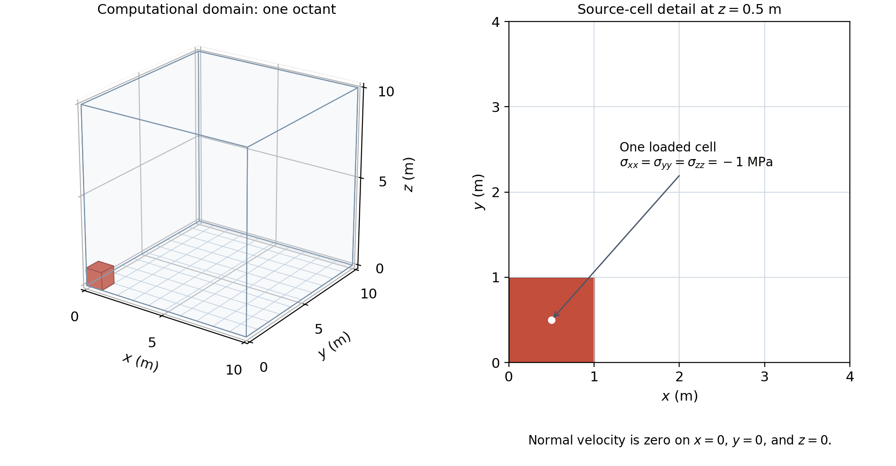
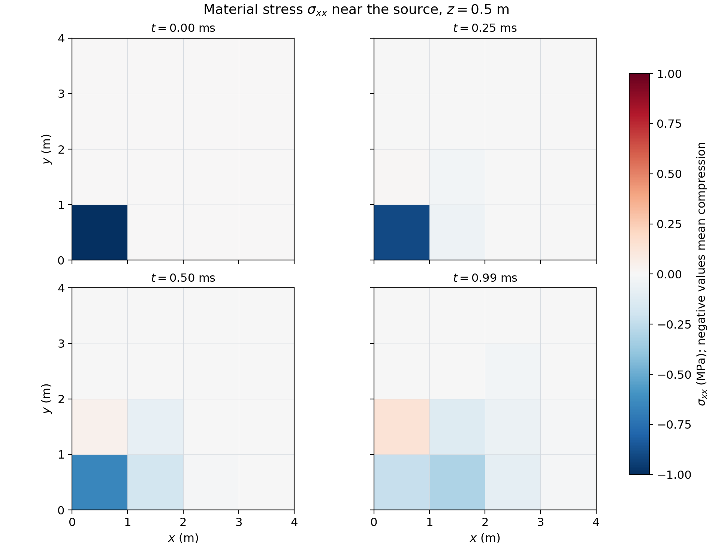
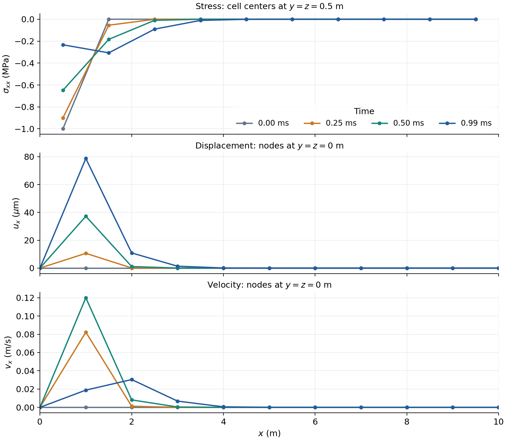
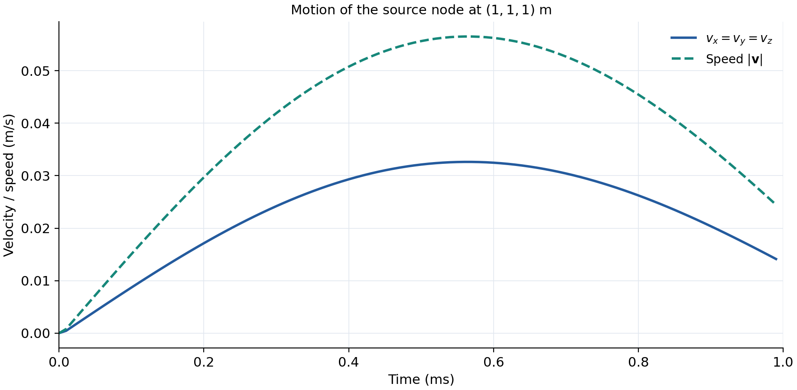

.. _SedovBasicExample:

############################################################
Elastic Wave Propagation from an Initial Stress (Sedov Test)
############################################################

**Context**

This example shows how an initial stress pulse produces motion in an elastic solid.
It uses the small-strain :ref:`SolidMechanicsLagrangianFEM` solver with explicit time integration.
The mesh, material, stress pulse, and time step match ``inputFiles/solidMechanics/sedov_ssle_smoke.xml``.
The outputs support visualization and the figures on this page.

The name *Sedov* follows the GEOS integrated tests.
Here, the material is an elastic solid.
This page does not compare its solution with the classical Sedov-Taylor gas-blast solution.

**Objectives**

At the end of this example, you will know how to:

* apply an initial stress to selected cells,
* set symmetry boundary conditions for explicit dynamics,
* control the time step and the order of events,
* collect material stress, displacement, and velocity,
* plot the initial state and the subsequent motion.

**Input file**

The standalone XML input is:

.. code-block:: console

   inputFiles/solidMechanics/sedov_basicExample.xml

You can also :download:`download the XML input <../../../../../inputFiles/solidMechanics/sedov_basicExample.xml>`.

The figure script is
:download:`make_sedov_figures.py <make_sedov_figures.py>`.
The checked-in :download:`results <sedovResults.npz>` and
:download:`data description <sedovResults.json>` reproduce the figures without a GEOS run.
The documentation build uses the existing images and does not run GEOS or the script.

-------------------
Domain and material
-------------------

The domain is a cube with sides of 10 m.
The mesh has 10 cells in each direction, for a total of 1 000 cells and 1 331 nodes.
Each ``C3D8`` cell is a trilinear hexahedron with eight quadrature points.
A quadrature point is a location where the finite element rule evaluates the material response.

.. literalinclude:: ../../../../../inputFiles/solidMechanics/sedov_basicExample.xml
   :language: xml
   :start-after: <!-- SPHINX_SEDOV_MESH -->
   :end-before: <!-- SPHINX_SEDOV_MESH_END -->

The material is isotropic and elastic.
Its density is 2 700 kg/m\ :sup:`3`, its bulk modulus is 5.5556 GPa, and its shear modulus is 4.16667 GPa.
These values use SI units in the XML input.

.. literalinclude:: ../../../../../inputFiles/solidMechanics/sedov_basicExample.xml
   :language: xml
   :start-after: <!-- SPHINX_SEDOV_MATERIAL -->
   :end-before: <!-- SPHINX_SEDOV_MATERIAL_END -->

The compression-wave speed :math:`c_p` and shear-wave speed :math:`c_s` are

.. math::

   c_p = \sqrt{\frac{K+4G/3}{\rho}} \simeq 2029\ \mathrm{m/s},
   \qquad
   c_s = \sqrt{\frac{G}{\rho}} \simeq 1242\ \mathrm{m/s}.

Here, :math:`K` is the bulk modulus, :math:`G` is the shear modulus, and :math:`\rho` is the density.
In 1 ms, a compression wave travels about 2 m.
The far faces of this domain are sufficiently distant for the short run shown here.
These speeds describe the elastic material; they are not a reference solution for the full discrete pulse.

   The computed domain and the loaded cell.
   The detail shows cell boundaries in the plane :math:`z=0.5` m.
   The negative faces of the cube are symmetry planes.

--------------------------------------
Initial stress and symmetry boundaries
--------------------------------------

The box named ``source`` selects the cell at the origin.
Its center is :math:`(0.5,0.5,0.5)` m.
The next cell center in each direction is at 1.5 m, outside the box.

.. literalinclude:: ../../../../../inputFiles/solidMechanics/sedov_basicExample.xml
   :language: xml
   :start-after: <!-- SPHINX_SEDOV_GEOMETRY -->
   :end-before: <!-- SPHINX_SEDOV_GEOMETRY_END -->

The three field specifications set the normal material stresses to -1 MPa in that cell.
Components 0, 1, and 2 are :math:`xx`, :math:`yy`, and :math:`zz`.
Negative normal stress means compression.
The shear stresses and the stresses in all other cells start at zero.

.. literalinclude:: ../../../../../inputFiles/solidMechanics/sedov_basicExample.xml
   :language: xml
   :start-after: <!-- SPHINX_SEDOV_SOURCE -->
   :end-before: <!-- SPHINX_SEDOV_SOURCE_END -->

Displacement and velocity also start at zero.
The localized stress is not in mechanical equilibrium.
The resulting internal forces produce motion when the explicit solver advances the state.
The input does not apply a continuing load or run an equilibrium solve first.

The negative faces are symmetry planes.
The normal velocity is zero on each plane; the two tangential components remain free.
The positive faces have no imposed load or velocity constraint.

.. literalinclude:: ../../../../../inputFiles/solidMechanics/sedov_basicExample.xml
   :language: xml
   :start-after: <!-- SPHINX_SEDOV_BOUNDARIES -->
   :end-before: <!-- SPHINX_SEDOV_BOUNDARIES_END -->

------------------------
Solver and time stepping
------------------------

``ExplicitDynamic`` selects the explicit solid-mechanics step.
The input uses the default small-strain formulation and turns gravity off.

.. literalinclude:: ../../../../../inputFiles/solidMechanics/sedov_basicExample.xml
   :language: xml
   :start-after: <!-- SPHINX_SEDOV_SOLVER -->
   :end-before: <!-- SPHINX_SEDOV_SOLVER_END -->

The run ends at 1 ms after 100 steps of 10 microseconds.
The solver event sets this fixed step with ``forceDt="1.0e-5"``.
That setting overrides the solver's time-step request.
The current FEM explicit step does not calculate a CFL-based stability limit.
Keep ``forceDt`` for this run.
Changing ``cflFactor`` alone does not make its time step safe.

.. note::

   An explicit step must satisfy the stability limit for its mesh and material.
   Review the step if you change either one.
   A fixed ``forceDt`` does not provide automatic protection after such changes.

------------------------
Collecting field results
------------------------

``PackCollection`` records a field in a buffer.
``TimeHistory`` writes the buffers to ``sedovHistory.hdf5``.
The collectors on this page record every cell or node.

.. literalinclude:: ../../../../../inputFiles/solidMechanics/sedov_basicExample.xml
   :language: xml
   :start-after: <!-- SPHINX_SEDOV_TASKS -->
   :end-before: <!-- SPHINX_SEDOV_TASKS_END -->

The material field ``shale_stress`` contains six stress components at each of the eight quadrature points.
The component order is :math:`xx,yy,zz,yz,xz,xy`.
The history stores these as 48 values per cell.
The figure script reshapes them into eight points with six components each.
``averageStress`` is a separate field with six components per cell.
``totalDisplacement`` and ``velocity`` each have three components per node.

The VTK output explicitly requests ``shale_stress`` with ``fieldNames``.
The default field selection omits this material field.
The VTK writer averages that current material field over the quadrature points.

.. literalinclude:: ../../../../../inputFiles/solidMechanics/sedov_basicExample.xml
   :language: xml
   :start-after: <!-- SPHINX_SEDOV_OUTPUTS -->
   :end-before: <!-- SPHINX_SEDOV_OUTPUTS_END -->

The event order is important.
The collectors and the outputs run before ``solverApplications``.
The record at :math:`t=0` therefore contains the initial conditions before any solver step.
Later records contain the state at their recorded time.

.. literalinclude:: ../../../../../inputFiles/solidMechanics/sedov_basicExample.xml
   :language: xml
   :start-after: <!-- SPHINX_SEDOV_EVENTS -->
   :end-before: <!-- SPHINX_SEDOV_EVENTS_END -->

The history has 100 records, from 0 to 0.99 ms.
The last history record precedes the last solver step.
Cleanup writes the final VTK and restart outputs at 1 ms.
It flushes the history buffer but does not add another history sample.
The plots below use their recorded times without a time shift.

.. important::

   GEOS calculates the initial ``averageStress`` after it applies the initial conditions.
   At :math:`t=0`, its three normal components are -1 MPa in the source cell and zero elsewhere.
   The explicit step currently updates the material stress but does not refresh ``averageStress``.
   Use the current material stress for plots of the subsequent wave.

The figure script averages ``shale_stress`` over the eight quadrature points in each cell.
An arithmetic mean is sufficient here because these regular cubes have equal integration weights.
For a general mesh, the cell average requires the integration weights.

-------------------
Running the example
-------------------

Run the following commands from the GEOS repository root.
Set ``geos_bin`` to your GEOS executable.
The temporary directory keeps the run outputs outside the source tree.

.. code-block:: console

   geos_bin=/path/to/your/build/bin/geosx
   run_dir=$(mktemp -d /tmp/geos-sedov-XXXXXXXX)
   "$geos_bin" -i inputFiles/solidMechanics/sedov_basicExample.xml -o "$run_dir" > "$run_dir/run.log" 2>&1

Open ``$run_dir/vtkOutput.pvd`` in ParaView to view all VTK snapshots.
Select ``shale_stress``, ``totalDisplacement``, or ``velocity``.
For :math:`\sigma_{xx}`, select component 0 of ``shale_stress``.
VTK stores stress in Pa; the figures below use MPa.
The final snapshot is at 1 ms.

To produce the figures from your run, use Python with ``numpy``, ``matplotlib``, and ``h5py``:

.. code-block:: console

   python3 src/docs/sphinx/basicExamples/sedov/make_sedov_figures.py \
     --history "$run_dir/sedovHistory.hdf5" --run-log "$run_dir/run.log" \
     --output-dir "$run_dir/figures"

The script checks the initial stress, zero initial motion, sampling times, and symmetry conditions before it plots.
It also writes a compact data file and a JSON description of the plotted results.
Use the unmodified input and a serial run for this script.
Parallel histories can contain a different point ordering and require additional handling.

------------------------
Wave propagation results
------------------------

The following maps show :math:`\sigma_{xx}` in the plane :math:`z=0.5` m.
The views show the first 4 m in the :math:`x` and :math:`y` directions, near the source.
Each colored square is one cell; no spatial interpolation or smoothing is applied.
All four panels use the same color scale.
The loaded cell begins at -1 MPa, and the stress later spreads to its neighbors.

   Material stress at four recorded times.
   Negative values mean compression.
   The last panel uses the last history sample at 0.99 ms.

The profiles below use cell centers at :math:`y=z=0.5` m for stress.
The displacement and velocity profiles use nodes on :math:`y=z=0` m.
Their markers include all 10 cells and all 11 nodes on those lines.
The coordinates refer to the undeformed mesh.

   Stress, displacement, and velocity profiles.
   Stress uses MPa, displacement uses micrometers, and velocity uses m/s.
   Lines connect the sampled points without smoothing.

The node at :math:`(1,1,1)` m is the outer corner of the loaded cell.
The cube symmetry makes its three velocity components equal.
Its speed is :math:`|\mathbf{v}|=\sqrt{v_x^2+v_y^2+v_z^2}`.
The following plot includes all 100 history samples.

   Velocity and speed at the source node.
   A component can change sign, whereas speed is nonnegative.

These results illustrate the discrete elastic response on a coarse mesh.
They are not an analytical verification or a mesh-convergence study.
The integrated tests compare related runs with stored references and check restart behavior.

-------------
To go further
-------------

* See :ref:`pygeosxInitialConditionModification` to change the initial stress through Python.
* See :ref:`SolidMechanicsLagrangianFEM` for the solid-mechanics solver.
* See :ref:`EventManager` for event order and timing.
* See :ref:`IntegratedTests` for regression tests, parallel partitions, and restart checks.

To reproduce the checked-in figures without a simulation, use Python with ``numpy`` and ``matplotlib``:

.. code-block:: console

   figures_dir=$(mktemp -d /tmp/geos-sedov-figures-XXXXXXXX)
   python3 src/docs/sphinx/basicExamples/sedov/make_sedov_figures.py \
     --data src/docs/sphinx/basicExamples/sedov/sedovResults.npz \
     --output-dir "$figures_dir"
