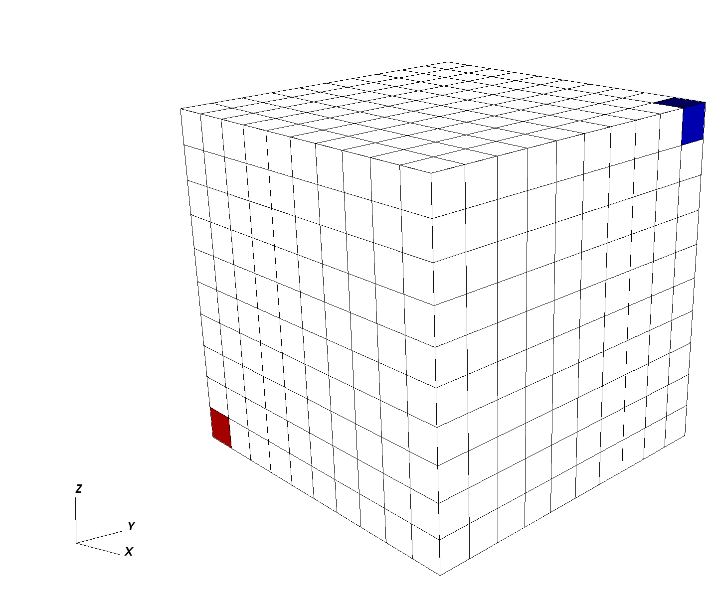
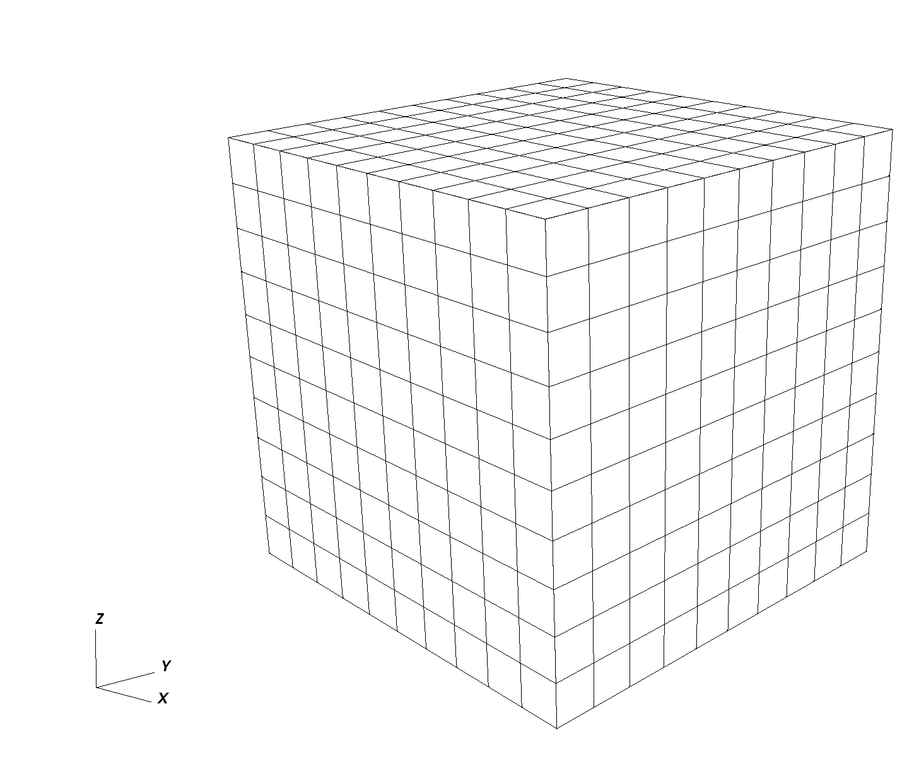
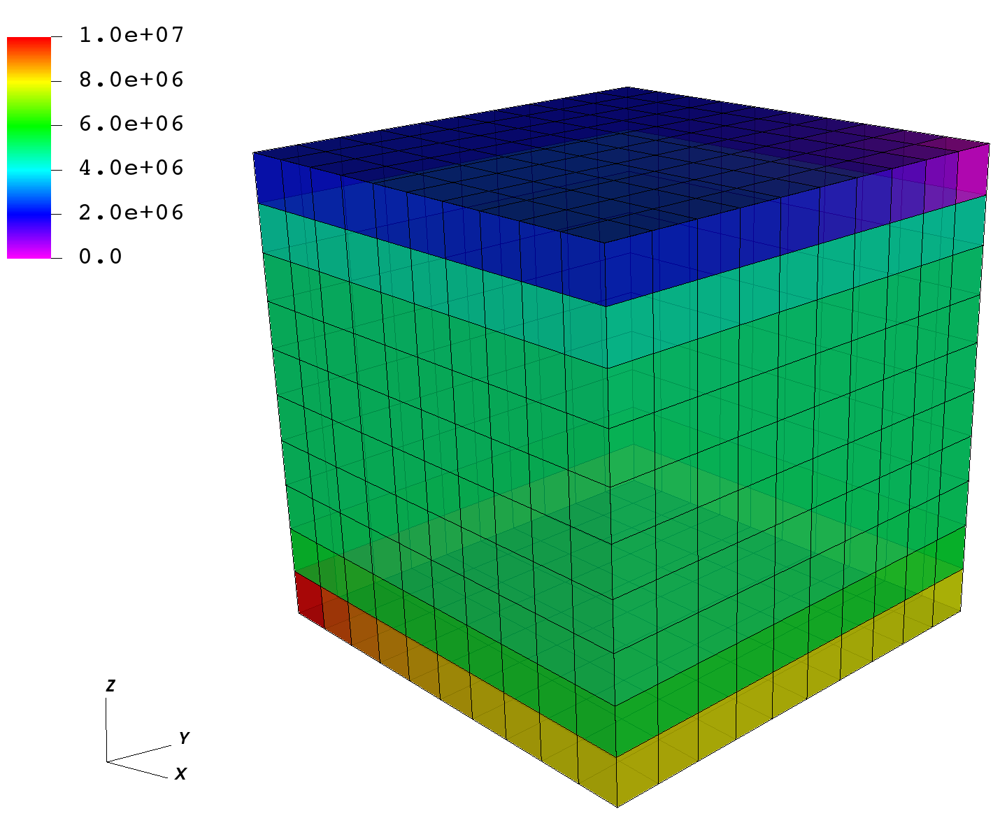
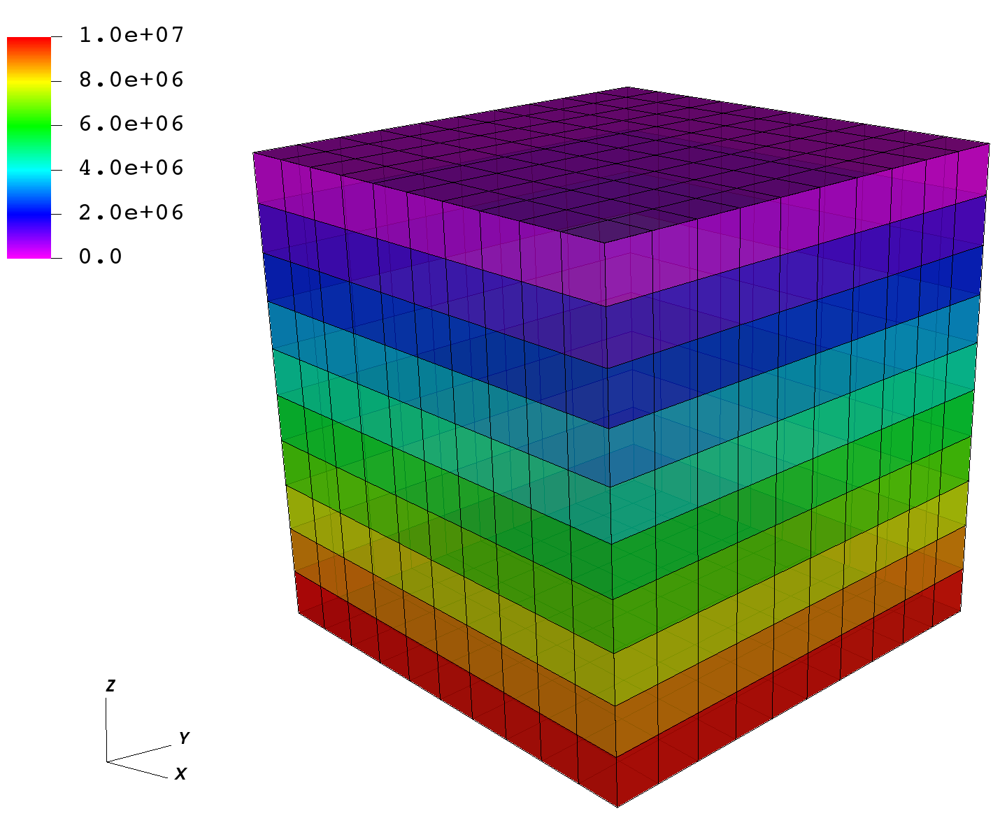

.. _TutorialSinglePhaseFlowWithInternalMesh:

#####################################################
Tutorial 1: First Steps
#####################################################

**Context**

In this tutorial, we use a single-phase flow solver (see :ref:`SinglePhaseFlow`)
to solve for pressure propagation on a 10x10x10 cube mesh
with anisotropic permeability values.
The pressure source is the lowest-left corner element, and the pressure sink sits at the opposite top corner.

**Objectives**

At the end of this tutorial you will know:

  - the basic structure of XML input files used by GEOS,
  - how to run GEOS on a simple case requiring no external mesh file,
  - how the blocks of an input file refer to each other by name,
  - how to control output and visualize results.

**Before you start**

This tutorial assumes that you have built and installed GEOS as described in the :ref:`QuickStart`,
and that the ``geos`` executable is on your ``PATH``
(in a build directory that has not been installed, the same executable is ``bin/geosx``).
All commands below are run from the root of the GEOS repository.

**Input files**

GEOS runs by reading user input information from one or more XML files.
This tutorial uses two files:

.. code-block:: console

    inputFiles/singlePhaseFlow/3D_10x10x10_compressible_smoke.xml
    inputFiles/singlePhaseFlow/3D_10x10x10_compressible_base.xml

The file you run is ``3D_10x10x10_compressible_smoke.xml``. It defines the mesh and the events,
and pulls in everything else from ``3D_10x10x10_compressible_base.xml`` through an ``Included`` block:

.. literalinclude:: ../../../../../inputFiles/singlePhaseFlow/3D_10x10x10_compressible_smoke.xml
  :language: xml
  :lines: 5-7

GEOS merges included files into a single input deck before running.
This is a common pattern in ``inputFiles``: a *base* file holds the physics,
and several small files (*smoke* tests, *benchmarks*, ...) reuse it with different meshes or run lengths.
Paths in an ``Included`` block are relative to the including file.

**Running GEOS**

.. code-block:: console

  geos -i inputFiles/singlePhaseFlow/3D_10x10x10_compressible_smoke.xml

The ``-i`` flag indicates the path to the XML input file.
To list the other command-line options, run ``geos --help`` (see also :ref:`RunningGEOS`).

**Input file structure**

XML files store information in a tree-like structure using nested blocks of information called *elements*.
In GEOS, the root of this tree structure is the element called ``Problem``.
All elements in an XML file are defined by an opening *tag* (``<ElementName>``) and end by a corresponding closing tag (``</ElementName>``). Elements can have properties defined as *attributes* with ``key="value"`` pairs.
A typical GEOS input file contains the following blocks, presented below in this order:

 #. :ref:`Mesh <Mesh_tag_single_phase_internal_mesh>`: the computational grid,
 #. :ref:`Geometry <Geometry_tag_single_phase_internal_mesh>`: named subsets of the mesh,
 #. :ref:`ElementRegions <ElementRegions_tag_single_phase_internal_mesh>`: groups of cells and the materials they contain,
 #. :ref:`Constitutive <Constitutive_tag_single_phase_internal_mesh>`: the properties of those materials,
 #. :ref:`NumericalMethods <NumericalMethods_tag_single_phase_internal_mesh>`: discretization schemes,
 #. :ref:`Solvers <Solver_tag_single_phase_internal_mesh>`: the physics to solve, and where,
 #. :ref:`FieldSpecifications <FieldSpecifications_tag_single_phase_internal_mesh>`: initial and boundary conditions,
 #. :ref:`Events <Events_tag_single_phase_internal_mesh>`: what happens when, including the end time,
 #. :ref:`Outputs <Outputs_tag_single_phase_internal_mesh>`: what is written to disk.

Blocks refer to each other by the user-defined ``name`` of their elements.
The order of the blocks in the file does not matter: a name can be used before the element that defines it.

**XML validation tools**

If you have not already done so, please use or enable an XML validation tool (see **User Guide/Input Files/Input Validation**).
Such tools will help you identify common issues that may occur when working with XML files.

.. note::
  Common errors come from the fact that XML is case-sensitive, and all opened tags must be properly closed.

.. _Mesh_tag_single_phase_internal_mesh:

------
Mesh
------

To solve this problem, we need to define a mesh for our numerical calculations.
This is the role of the **Mesh** element.

There are two approaches to specifying meshes in GEOS: internal or external.

  * The external approach allows to import mesh files created outside GEOS, such as a corner-point grid or an unstructured grid representing complex shapes and structures.
  * The internal approach uses GEOS's built-in capability to create simple meshes from a small number of parameters. It does not require any external file information. The geometric complexity of internal meshes is limited, but many practical problems can be solved on such simple grids.

In this tutorial, to keep things self-contained,
we use the internal mesh generator. We parameterize it with the **InternalMesh** element.

.. literalinclude:: ../../../../../inputFiles/singlePhaseFlow/3D_10x10x10_compressible_smoke.xml
  :language: xml
  :start-after: <!-- SPHINX_TUT_INT_HEX_MESH -->
  :end-before: <!-- SPHINX_TUT_INT_HEX_MESH_END -->

**name**

Giving elements a ``name`` is a common practice in GEOS:
the name is the handle that other parts of the input file use to refer to an object.
Here the ``InternalMesh`` object is instantiated with the name ``mesh``.
Names are case-sensitive (``mesh`` and ``Mesh`` are different), and should not contain commas, slashes or curly braces.

**elementTypes, cellBlockNames**

We specify the collection of element types that this mesh contains.
Tetrahedra, hexahedra, and wedges are examples of element types.
Curly brackets are used in GEOS inputs to indicate collections of values (sets or lists),
and they are required even if the collection contains a single value.
Commas separate members of a collection.
Our mesh has only one type of element: ``C3D8``, a hexahedral element (linear 8-node brick).

For numerical convenience, elements are aggregated by type into *cell blocks*.
Here, all elements are bricks, so the entire domain is a single cell block, named ``cellBlock`` by the ``cellBlockNames`` attribute.

**xCoords, yCoords, zCoords, nx, ny, nz**

This specifies the spatial arrangement of the mesh elements.
The mesh defined here goes from coordinate x=0 to x=10 in the x-direction, with ``nx=10`` subdivisions along this segment.
The same is true for the y-dimension and the z-dimension.
Our mesh is a cube of 10x10x10=1,000 elements with a bounding box defined by corner coordinates (0,0,0) and (10,10,10).
All lengths are in meters: GEOS uses S.I. units throughout.

.. _Geometry_tag_single_phase_internal_mesh:

---------
Geometry
---------

The ``Geometry`` tag allows users to capture subregions of a mesh and assign them a unique name.
Here, we name two ``Box`` elements, one for the location of the ``source`` and one for the ``sink``.
Pressure values are assigned to these named regions in the ``FieldSpecifications`` block.

The pressure source is the element in the (0,0,0) corner of the domain, and the sink is the element in the (10,10,10) corner.

For an element to be inside a geometric region,
it must have all its vertices strictly inside that region.
Consequently, we need to extend the geometry limits a small amount beyond the actual coordinates of the elements to catch all vertices. Here, we use a safety padding of 0.01.

.. literalinclude:: ../../../../../inputFiles/singlePhaseFlow/3D_10x10x10_compressible_base.xml
  :language: xml
  :start-after: <!-- SPHINX_TUT_INT_HEX_GEOMETRY -->
  :end-before: <!-- SPHINX_TUT_INT_HEX_GEOMETRY_END -->

There are several methods to achieve similar conditions (Dirichlet boundary condition on faces, etc.).
The ``Box`` defined here is one of the simplest approaches.

.. _ElementRegions_tag_single_phase_internal_mesh:

--------
Regions
--------

In GEOS, ``ElementRegions`` are used to attach materials to groups of cells.
Here, we use only one **CellElementRegion** to represent the entire domain (user name: ``mainRegion``).
``cellBlocks="{ * }"`` means that the region contains all the cell blocks defined in the mesh, here the single ``cellBlock``.
We specify the materials contained in that region using a ``materialList``,
listing them by their user-defined names: ``water`` and ``rock``.
Each material is defined in the ``Constitutive`` block.

.. literalinclude:: ../../../../../inputFiles/singlePhaseFlow/3D_10x10x10_compressible_base.xml
  :language: xml
  :start-after: <!-- SPHINX_TUT_INT_HEX_ELEM_REGIONS -->
  :end-before: <!-- SPHINX_TUT_INT_HEX_ELEM_REGIONS_END -->

The ``materialList`` is how physics solvers find the models they need:
a solver applied to ``mainRegion`` looks in this list for a fluid model and a solid model.

.. _Constitutive_tag_single_phase_internal_mesh:

---------------------
Constitutive models
---------------------

The ``Constitutive`` element defines the physical properties of all materials used in the domain.

.. literalinclude:: ../../../../../inputFiles/singlePhaseFlow/3D_10x10x10_compressible_base.xml
  :language: xml
  :start-after: <!-- SPHINX_TUT_INT_HEX_CONSTITUTIVE -->
  :end-before: <!-- SPHINX_TUT_INT_HEX_CONSTITUTIVE_END -->

The two materials listed in the region are:

  * ``water``, a ``CompressibleSinglePhaseFluid`` with a reference density, viscosity, and compressibility,
  * ``rock``, a ``CompressibleSolidConstantPermeability``. This is a *composite* model: it does not hold properties itself,
    but combines three other models by name:

    * ``solidModelName="nullSolid"``: the mechanical model of the rock. Mechanics is not solved here, so we use a ``NullModel``.
    * ``porosityModelName="rockPorosity"``: a ``PressurePorosity`` model, where porosity varies with pressure through a compressibility.
    * ``permeabilityModelName="rockPerm"``: a ``ConstantPermeability`` model with permeability components (kx, ky, kz).

Only ``water`` and ``rock`` appear in the region's ``materialList``; the three sub-models are found through the ``rock`` model.
This solid + porosity + permeability composition is used throughout GEOS flow and poromechanics examples.

GEOS uses S.I. units throughout, not field units.
Pressures, for instance, are in Pascal, not psia.
The x- and y-permeability are set to 1.0e-12 m\ :sup:`2`, approximately 1 Darcy.

.. _NumericalMethods_tag_single_phase_internal_mesh:

------------------
Numerical methods
------------------

GEOS comes with several numerical methods. The ``NumericalMethods`` block defines discretization schemes and gives them a name.
Here we define a Two-Point Flux Approximation (TPFA) finite volume scheme named ``singlePhaseTPFA``.

.. literalinclude:: ../../../../../inputFiles/singlePhaseFlow/3D_10x10x10_compressible_base.xml
  :language: xml
  :start-after: <!-- SPHINX_TUT_INT_HEX_NUM_METHODS -->
  :end-before: <!-- SPHINX_TUT_INT_HEX_NUM_METHODS_END -->

In GEOS, physics solvers and numerical methods are defined separately.
Several solvers can use the same numerical scheme, with different tolerances for instance.
See :ref:`NumericalMethodsManager` for the available schemes.

.. _Solver_tag_single_phase_internal_mesh:

-------------------
Single-phase solver
-------------------

GEOS is a multiphysics simulator. To find the solution to different physical problems
such as diffusion or mechanical deformation, GEOS uses one or more physics solvers.
The ``Solvers`` tag is used to define and parameterize these solvers.
Different combinations of solvers can be applied
in different regions of the domain at different moments of the simulation.

In this first example, we use one solver in the entire domain and
for the entire duration of the simulation:
a single-phase flow solver, created with a ``SinglePhaseFVM`` element.
This is one among several cell-centered single-phase finite volume methods.

.. literalinclude:: ../../../../../inputFiles/singlePhaseFlow/3D_10x10x10_compressible_base.xml
  :language: xml
  :start-after: <!-- SPHINX_TUT_INT_HEX_SOLVERS -->
  :end-before: <!-- SPHINX_TUT_INT_HEX_SOLVERS_END -->

Each type of solver has a specific set of parameters that are required and
some parameters that are optional. Optional values are usually set with sensible default values.

**name**

The solver is named ``SinglePhaseFlow``. The ``Events`` block uses this name to tell GEOS when to run the solver.

**logLevel**

``logLevel`` controls how much this solver prints to the console (here, 1).
Notice that the value is between double-quotes:
we write ``key="value"`` regardless of the value type (integers, strings, lists, etc.).
Higher values lead to more console output, which is convenient when debugging.

**discretization**

For solvers of the ``SinglePhaseFVM`` family, a discretization scheme is required.
Here, we use the TPFA scheme named ``singlePhaseTPFA`` in the ``NumericalMethods`` block.

**targetRegions**

The list of regions where the solver is applied, here ``mainRegion``.
The solver finds its fluid and rock models through the ``materialList`` of these regions,
so no material names are given in the solver block.

**Nested elements**

Other XML elements can be nested inside the solver element.
Here, ``NonlinearSolverParameters`` sets the Newton tolerance and maximum number of iterations,
and ``LinearSolverParameters`` selects an iterative linear solver (GMRES with an algebraic multigrid preconditioner).
The Newton loop stops when the residual is smaller than ``newtonTol`` (convergence achieved)
or when ``newtonMaxIter`` is exceeded (convergence not achieved, and the time step is cut).

To know the list of admissible attributes of any element, see the :doc:`Datastructure Index </docs/sphinx/datastructure/CompleteXMLSchema>`.

.. _FieldSpecifications_tag_single_phase_internal_mesh:

--------------------
Defining properties
--------------------

In the ``FieldSpecifications`` section, initial conditions and source and sink pressures are set.
GEOS offers a lot of flexibility to specify field values through space and time.

Spatially, in GEOS, all field specifications are associated
to a target object on which the field values are mounted.
This allows for a lot of freedom in defining fields:
for instance, one can have volume property values attached to
a subset of volume elements of the mesh,
or surface properties attached to faces of a subset of elements.

For each ``FieldSpecification``, we specify:

  * a ``name``,
  * a ``fieldName``, the field being set (here ``pressure``),
  * an ``objectPath``, the object holding the field. ``ElementRegions/mainRegion/cellBlock`` targets the cells of the ``cellBlock`` sub-region of ``mainRegion``,
  * ``setNames``, the subsets of that object where the value applies: the boxes defined in ``Geometry``, or ``all`` for every cell,
  * a ``scale``, the value applied (here in Pascal).

The ``initialPressure`` specification has ``initialCondition="1"``: it is applied once, at the start of the simulation, to initialize the whole domain at 5 MPa.
The ``sourceTerm`` and ``sinkTerm`` specifications are applied at every time step, holding the source at 10 MPa and the sink at 0 MPa.

.. literalinclude:: ../../../../../inputFiles/singlePhaseFlow/3D_10x10x10_compressible_base.xml
  :language: xml
  :start-after: <!-- SPHINX_TUT_INT_HEX_FIELDS -->
  :end-before: <!-- SPHINX_TUT_INT_HEX_FIELDS_END -->

The image below shows the pressures after the very first time step, with the domain initialized at 5 MPa, the sink at 0 MPa on the top right, and the source in the lower left corner at 10 MPa.

.. _Events_tag_single_phase_internal_mesh:

--------
Events
--------

In GEOS, we call ``Events`` anything that happens at a set time or frequency.
Events drive time-stepping in GEOS; see :ref:`EventManager` for a complete description.

.. literalinclude:: ../../../../../inputFiles/singlePhaseFlow/3D_10x10x10_compressible_smoke.xml
  :language: xml
  :start-after: <!-- SPHINX_TUT_INT_HEX_EVENTS -->
  :end-before: <!-- SPHINX_TUT_INT_HEX_EVENTS_END -->

The ``maxTime`` attribute of ``Events`` sets the end of the simulation.
In GEOS, all times are specified in **seconds**, so ``maxTime="5000.0"`` means that the simulation runs from time 0 to time 5,000 seconds.

The two ``PeriodicEvent`` elements are:

 #. A **solver event**, named ``solverApplications``. Its ``target`` attribute, ``/Solvers/SinglePhaseFlow``, points to the solver defined above:
    the '/' separators give the path to a named instance (``SinglePhaseFlow``) inside a block (``Solvers``).
    With ``forceDt="20.0"``, the solver advances in 20-second time steps until ``maxTime``.
    If the solver fails to converge, it can cut the time step and take smaller sub-steps to reach the end of each 20-second interval.
 #. An **output event**, named ``outputs``, targeting ``/Outputs/siloOutput``. It writes results every 100 seconds (``timeFrequency="100.0"``).
    An output event does not run the solver: it writes the current state of the simulation.
    By default, GEOS adjusts the time steps so that outputs happen exactly at the requested times.

.. _Outputs_tag_single_phase_internal_mesh:

-------
Output
-------

In order to retrieve results from a simulation,
we need to instantiate one or multiple ``Outputs``.

Here, we define a single object of type ``Silo``, named ``siloOutput``.
This is the object targeted by the ``outputs`` event above.
`Silo <https://silo.readthedocs.io>`_ is a library and a format for scientific data,
which can be read by `VisIt <https://visit-dav.github.io/visit-website/>`_.

.. literalinclude:: ../../../../../inputFiles/singlePhaseFlow/3D_10x10x10_compressible_base.xml
  :language: xml
  :start-after: <!-- SPHINX_TUT_INT_HEX_OUTPUTS -->
  :end-before: <!-- SPHINX_TUT_INT_HEX_OUTPUTS_END -->

To visualize results with `ParaView <https://www.paraview.org>`_ instead, use a ``VTK`` output,
for instance ``<VTK name="vtkOutput"/>``, and set the target of the output event to ``/Outputs/vtkOutput``.
See :doc:`/coreComponents/fileIO/doc/OutputTasks` for all output formats.

All elements are now in place to run GEOS.

------------------------------------
Running GEOS
------------------------------------

From the root of the repository, run:

.. code-block:: console

  geos -i inputFiles/singlePhaseFlow/3D_10x10x10_compressible_smoke.xml

Paths to files referenced inside an XML file (included files, external meshes, tables) are relative to that XML file.
Output files are written to the current directory, unless another directory is given with ``-o``.

While running, GEOS logs status information to the console, with a verbosity controlled by the ``logLevel`` attribute of each object.

  * First, GEOS reads the input files and creates the objects they define (mesh, regions, constitutive models, solvers, events).
  * Then, for every time step, GEOS prints a line with the current time, time step size and cycle number (``Time: ..., dt: ... s, Cycle: ...``),
    followed by the Newton iterations of the solver, with the nonlinear residual at each iteration
    and the number of iterations of the linear solver.
  * At the end of a successful simulation, GEOS prints timing and memory usage information.

Congratulations on completing this first run!

------------------------------------
Visualization
------------------------------------

Here, we have requested results to be written in Silo format. To visualize results, open VisIt
and load the database of simulation output files written in the current directory.

After a few time steps, pressure between the source and sink reaches equilibrium, as shown below.

------------------------------------
To go further
------------------------------------

**Feedback on this tutorial**

This concludes the single-phase internal mesh tutorial.
For any feedback on this tutorial, please submit a `GitHub issue on the project's GitHub page <https://github.com/GEOS-DEV/GEOS/issues>`_.

**For more details**

  - More on single-phase flow solvers, please see :ref:`SinglePhaseFlow`.
  - More on meshes, please see :ref:`Meshes`.
  - More on events, please see :ref:`EventManager`.
  - More on running GEOS, please see :ref:`RunningGEOS`.
