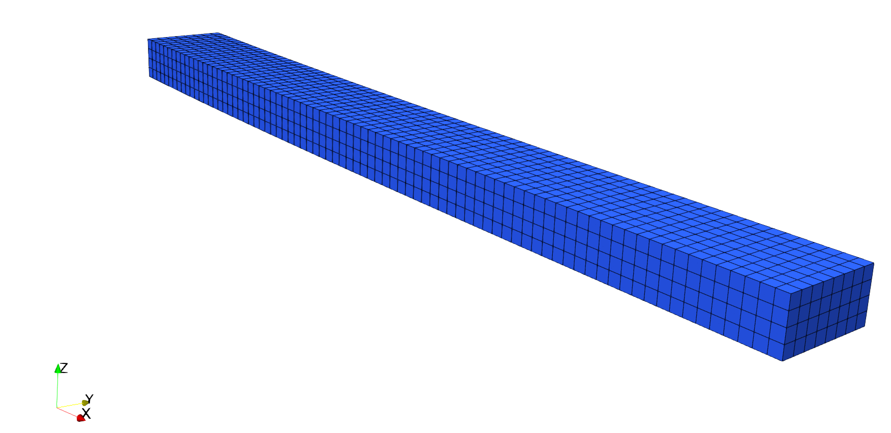
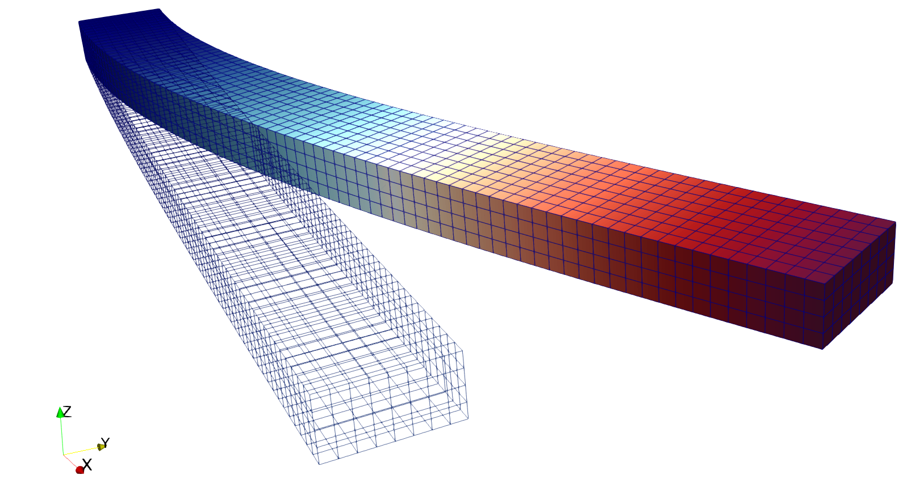

.. _TutorialElasticity:

############################################################
Tutorial 4: Boundary Conditions and Time-Dependent Functions
############################################################

**Context**

In this tutorial, we use a small strain linear elastic based solid mechanics solver
(see :ref:`SolidMechanicsLagrangianFEM`) from GEOS to solve for the bending problem of
a three-dimensional cantilever beam. The beam is fixed at one end, and subjects to a traction force pointing to the y-positive direction on the other end. The beam is deformed in the x-y plane.

**Objectives**

At the end of this tutorial, you will know:

  - how to use the solid mechanics solver to solve a quasistatic problem,
  - how to set up displacement boundary condition at element nodes,
  - how to set up traction boundary condition on element surfaces,
  - how to use a table function to control time-dependent loading.

**Input file**

This tutorial uses no external mesh file. As in the previous tutorials, the physics is defined in a *base* file,
which is included by the file you run:

.. code-block:: console

  inputFiles/solidMechanics/beamBending_base.xml
  inputFiles/solidMechanics/beamBending_benchmark.xml

A lighter version of the case, ``beamBending_smoke.xml``, includes the same base file; the finite element discretization shown below is taken from it.

------------------------------------
Discretized computational domain
------------------------------------

The following mesh is used in this tutorial:

This mesh contains 80 x 8 x 4 eight-node brick elements in the x, y and z directions, respectively.
Here, the ``InternalMesh``
is used to generate a structured three-dimensional mesh with ``C3D8`` as
the ``elementTypes``. This mesh is defined as a cell block with the name
``cb1``.

.. literalinclude:: ../../../../../inputFiles/solidMechanics/beamBending_benchmark.xml
  :language: xml
  :start-after: <!-- SPHINX_BeamBendingMesh -->
  :end-before:  <!-- SPHINX_BeamBendingMeshEnd -->

------------------------------------
Gravity
------------------------------------
The gravity is turned off explicitly at the beginning of the input file:

.. literalinclude:: ../../../../../inputFiles/solidMechanics/beamBending_benchmark.xml
  :language: xml
  :start-after: <!-- SPHINX_Gravity -->
  :end-before:  <!-- SPHINX_GravityEnd -->

------------------------------------
Solid mechanics solver
------------------------------------
The solid mechanics solver is based on the small strain Lagrangian finite element formulation.
The problem is run as ``QuasiStatic`` without considering the beam inertial. The computational
domain is discretized by ``FE1``,
which is defined in the ``NumericalMethods`` block. The solver is applied to the region ``Region2``.
As in the flow tutorials, the solver does not name a material: it uses the solid model listed in the
``materialList`` of ``Region2`` (here ``shale``), whose properties are defined in the
``Constitutive`` block.

.. literalinclude:: ../../../../../inputFiles/solidMechanics/beamBending_benchmark.xml
  :language: xml
  :start-after: <!-- SPHINX_SolidMechanicsSolver -->
  :end-before:  <!-- SPHINX_SolidMechanicsSolverEnd -->

------------------------------------
Finite element discretization
------------------------------------
The computational domain is discretized by ``C3D8`` elements with the first order interpolation
functions at each direction in the parent domain. The 2 x 2 x 2 Gauss quadrature rule is adopted to be
compatible with the first order interpolation functions.

.. literalinclude:: ../../../../../inputFiles/solidMechanics/beamBending_smoke.xml
  :language: xml
  :start-after: <!-- SPHINX_FEDiscretization -->
  :end-before:  <!-- SPHINX_FEDiscretizationEnd -->

------------------------------------
Constitutive model
------------------------------------
The material ``shale``, listed in the ``materialList`` of ``Region2``, is defined here as linear isotropic elastic.

.. literalinclude:: ../../../../../inputFiles/solidMechanics/beamBending_base.xml
  :language: xml
  :start-after: <!-- SPHINX_Material -->
  :end-before:  <!-- SPHINX_MaterialEnd -->

------------------------------------
Boundary conditions
------------------------------------
As aforementioned, the beam is fixed on one end, and subjects to surface traction on
the other end. These boundary conditions are set up through the ``FieldSpecifications`` block:

  * The fixed end uses ``FieldSpecification`` elements on the ``totalDisplacement`` field, with ``objectPath="nodeManager"``:
    the displacement is imposed at the mesh nodes.
    Component ``0``, ``1``, and ``2`` refer to the x, y, and z direction, respectively, and ``scale`` gives the imposed value (here zero).
  * The loaded end uses a ``Traction`` element, with ``objectPath="faceManager"``: the traction is applied on mesh faces.
    Its magnitude is given by ``scale`` (1 MPa), its direction by ``direction`` (here, the y-direction),
    and its time variation by the function named ``timeFunction`` (see below).

The sets ``xneg`` and ``xpos`` designate the nodes (and faces) on the left-most and right-most boundaries of the domain in the x-direction.
Similar sets ``yneg``, ``ypos``, ``zneg``, and ``zpos`` exist for the other directions.
These six sets are created automatically by the ``InternalMesh`` generator; with an external mesh, boundary sets must be defined
in the mesh file or with a ``Geometry`` block.

.. literalinclude:: ../../../../../inputFiles/solidMechanics/beamBending_base.xml
  :language: xml
  :start-after: <!-- SPHINX_BoundaryConditions -->
  :end-before:  <!-- SPHINX_BoundaryConditionsEnd -->

------------------------------------
Table function
------------------------------------
A table function is used to define the time-dependent loading at the beam tip. The ``coordinates`` and ``values`` form a time-magnitude
pair for the loading time history. In this case, the loading magnitude increases linearly as the time evolves.

.. literalinclude:: ../../../../../inputFiles/solidMechanics/beamBending_base.xml
  :language: xml
  :start-after: <!-- SPHINX_TableFunction -->
  :end-before:  <!-- SPHINX_TableFunctionEnd -->

------------------------------------
Execution
------------------------------------
Finally, the execution of the simulation is set up in the ``Events`` block, where
``target`` points to the solid mechanics solver defined in the ``Solvers`` block, and
the time increment ``forceDt`` is set as 1.0s.

.. literalinclude:: ../../../../../inputFiles/solidMechanics/beamBending_base.xml
  :language: xml
  :start-after: <!-- SPHINX_Execution -->
  :end-before:  <!-- SPHINX_ExecutionEnd -->

------------------------------------
Result
------------------------------------
To run the case, from the root of the repository:

.. code-block:: console

  geos -i inputFiles/solidMechanics/beamBending_benchmark.xml

The input file writes the deformed mesh in ``Silo`` format, and a ``TimeHistory`` output (``displacement_history.hdf5``)
with the displacement along a line of nodes (the ``trace`` box), collected by a ``PackCollection`` task.
The analytical solution for the deflection of a cantilever beam, used by the GEOS test suite to check this case,
is implemented in ``inputFiles/solidMechanics/beamBending_curve.py``.

The deformed beam is shown as following (notice that the displacement is visually magnified):

------------------------------------
To go further
------------------------------------

**Feedback on this tutorial**

This concludes the solid mechanics for small-strain linear elasticity tutorial.
For any feedback on this tutorial, please submit a `GitHub issue on the project's GitHub page <https://github.com/GEOS-DEV/GEOS/issues>`_.

**For more details**

  - More on meshes, please see :ref:`Meshes`.
  - More on events, please see :ref:`EventManager`.
  - More on running GEOS (in parallel, restarting), please see :ref:`RunningGEOS`.

**Next steps**

You now know the basic building blocks of a GEOS input file.
The :ref:`BasicExamples` show complete problems organized by physical process (multiphase flow, wells, CO\ :sub:`2` injection, poromechanics, hydraulic fracturing).
